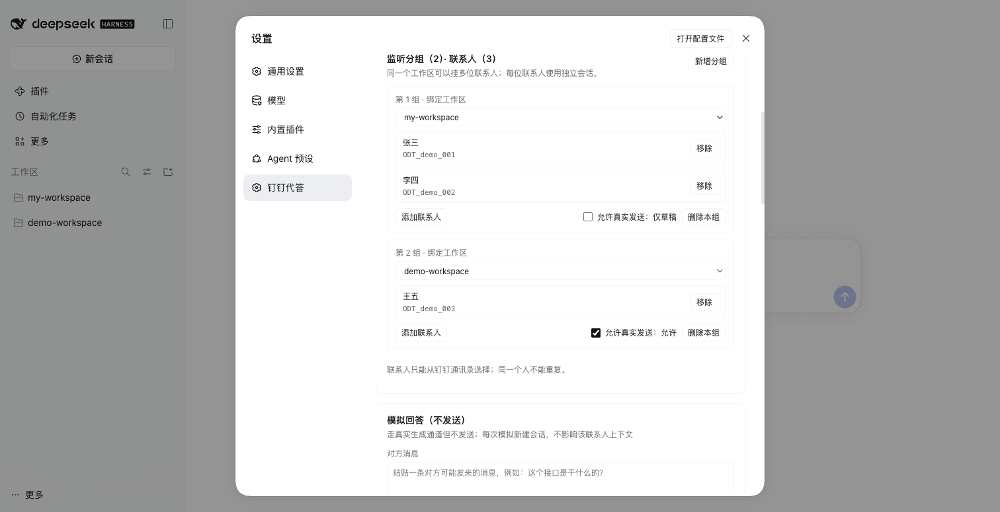
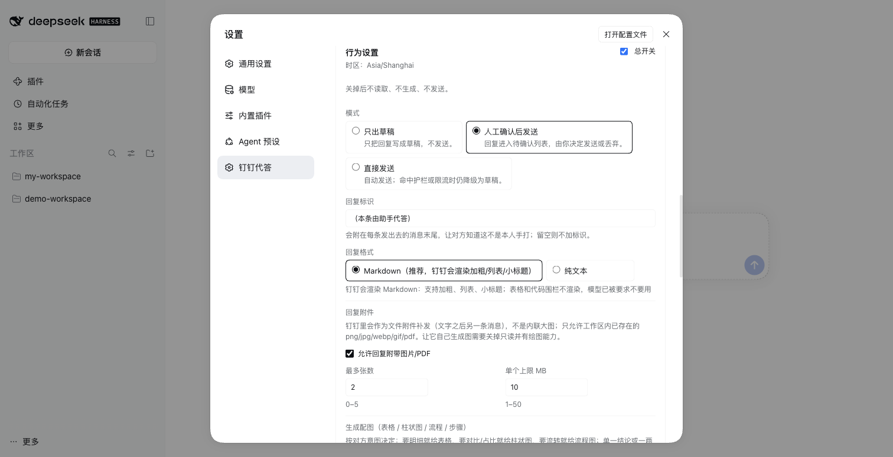

# dsh-dingtalk-self

> **English TL;DR** — A DeepSeek Harness (dsh) plugin that answers DingTalk direct messages **as your own account**. It watches the chats you pick, asks the agent (bound to a DSH workspace) to look the answer up, and sends it back through the `dws` CLI with an opt-out marker line. No bot account, no forwarded questions. Requires macOS + `dws auth login`; replies are Markdown, and tables/charts/flow diagrams can be rendered to PNG by the host.

DSH 插件：**钉钉代答**。别人在钉钉问你，agent 自己去你绑定的工作区里查资料，然后**以你本人身份**直接答复对方——
你不用把问题转发给 agent，对方收到的也是「你」发的普通消息，不是机器人、不是数字员工账号。

---

## 它和普通钉钉插件的区别

| | 机器人 / 自建应用插件 | 本插件 |
|---|---|---|
| 发送身份 | 机器人 | **你本人** |
| 读取范围 | 机器人被拉进的群 | **你的私聊** |
| AI 角标 | 有 | 关闭（`--ai-tag=false`） |
| 回复内容来源 | 插件自带 prompt | **你绑定的 DSH 工作区** |
| 权限 | 插件的权限 | **工作区只读（仅可查看）** |

链路：

```
对方私聊你
   ↓  dws chat message list --open-dingtalk-id   （以你身份读）
过滤 / 去重 / 合并
   ↓  投递到绑定的 DSH 工作区（仅可查看）
生成回复
   ↓  出站护栏（禁代码 / 禁路径 / 禁内网地址）
dws chat message send --ai-tag=false --idempotency-key
   ↓
对方看到「你」发的普通消息
```

---

## 安装

```bash
# 1. 装进你的 profile（路径改成你的实际目录；日常用桌面版就是 desktop）
dsh plugin --profile desktop add ~/projects/dsh-dingtalk-self

# 2. 重启 DSH App，然后刷新页面
# 3. 打开 设置 → 钉钉代答（设置侧栏里，order=45）
```

装好后检查两处（缺一不可）：

```bash
python3 -c "import json;d=json.load(open('$HOME/.dsh/profiles/desktop/package.json'));print('deps:', 'dsh-dingtalk-self' in d['dependencies'], 'bundles:', 'dsh-dingtalk-self' in d['dsh']['profile']['bundles'])"
cat ~/.dsh/data/dsh-dingtalk-self/boot.log   # 应有一行 version=0.2.0 ... schema=yes
```

- 客户端半边（设置页）由 `package.json` 的 `dsh.client` 声明，**普通 JS、无需构建**；
  重装/改代码后必须重启 App 才会重新装配（实测 Host 侧改代码不会热重载插件）。

卸载：

```bash
dsh plugin --profile web remove dsh-dingtalk-self
```

> `dsh` 不在 PATH 时用全路径：
> `/Applications/DeepSeek\ Harness.app/Contents/Resources/runtime/cli/bin/dsh`

### 前置条件（缺一不可）

1. **`dws` 已安装**（`dws --version` 有输出）
2. **已完成个人 OAuth 登录**：

```bash
dws auth login          # 扫码授权
dws auth status         # 应返回 "authenticated": true
```

   ⚠️ `dws auth login` 必须在你自己的终端里执行 —— 在 Agent 沙箱里跑会因无法写 `~/.dws` 而 `EPERM`。

3. **有一个可绑定的 DSH 工作区**（侧栏里那个，例如 `my-workspace`）

---

## 设置页（client 半边）

`设置 → 钉钉代答` 一页完成全部操作，不需要手改配置文件：

| 区块 | 内容 |
|---|---|
| 运行状态 | dws 登录态 / 本人 userId、急停开关、**立即检查一次**、**上次检查**（读了几条 / 新私聊几条 / 出了什么）、重新诊断、刷新、版本、配置来源、计数 |
| 监听分组 | **一个工作区挂多位联系人**：每组一张卡 = 工作区下拉 + 成员列表（从钉钉通讯录搜索选人，姓名/ID 只读）+ 组级「允许真实发送」。每位联系人使用独立会话，互不串上下文 |
| 行为设置 | 总开关、三档模式、轮询间隔、每小时上限、回复字数上限、静默时段 |
| 模拟回答 | 粘贴一条对方可能发来的消息，走真实生成通道跑一遍但**不发送**，看它会怎么答（可能耗时 1–3 分钟） |
| 待确认草稿 | 每条可「发送」/「丢弃」 |
| 最近草稿 / 最近审计 | 新的在前，用于回看为什么回/为什么没回 |
| 自检 | 一键六项：Node、状态目录、dws 可执行、个人身份登录、工作区、联系人绑定 |





数据通道（契约见 [`docs/client-host-api.md`](docs/client-host-api.md)）：客户端不直连宿主服务，
而是访问插件自己注册的五个同源 HTTP 端点：

```
GET  /dsh-dingtalk-self/api/state
POST /dsh-dingtalk-self/api/config     { patch }
POST /dsh-dingtalk-self/api/pause      { paused }
POST /dsh-dingtalk-self/api/confirm    { contact, action }
POST /dsh-dingtalk-self/api/diagnose
POST /dsh-dingtalk-self/api/contacts/search   { query }
POST /dsh-dingtalk-self/api/cycle              {}   // 立即检查一次
POST /dsh-dingtalk-self/api/test-reply         { message }   // 模拟回答，不发送
```

**配置存放位置（当前 DSH 版本）**：本机 `settings` 服务没有 `register`，`describe()` 也不返回插件条目，
所以配置落在 `~/.dsh/data/dsh-dingtalk-self/config.json`，设置页里「配置来源」会显示这一点。
宿主若提供可写的 `settings.update`，代码会优先走 DSH 原生 settings（响应里的 `configSource: "settings"`）。

---

## 配置

设置页里的字段与含义（同一份 schema 也是 `lib/settings.js` 里的 `Config`）：

| 字段 | 默认 | 说明 |
|---|---|---|
| `enabled` | `false` | 总开关，默认关 |
| `mode` | `draft` | `draft` 只出草稿 / `confirm` 等人工确认 / `auto` 直接发 |
| `selfUserId` | 空 | 你的 userId，用于过滤自己发的消息 |
| `contacts[]` | `[]` | 监控名单，空 = 什么都不做 |
| `contacts[].name` | — | 联系人名，用于日志与会话标题 |
| `contacts[].openDingTalkId` | — | 对方 ID（设置页从通讯录选人时自动带入，发送时免反查） |
| `contacts[].workspaceId` | — | **绑定到哪个 DSH 工作区**（存工作区 id，界面显示标题；同一个人一个条目，同一工作区多人 = 多条 `workspaceId` 相同的联系人） |
| `contacts[].autoReply` | `false` | 是否允许真实发送 |
| `contacts[].sessionId` | 空 | 指定要接管的会话；留空时由插件在首次生成后自动记录（`state.sessions`），每人的上下文互相隔离 |
| `pollIntervalSeconds` | `60` | 轮询间隔（≥10） |
| `initialLookbackSeconds` | `900` | **首次启用**（还没有游标）时回看多久的私聊；之后只看 `overlapSeconds` |
| `mergeWindowSeconds` | `20` | 连发合并窗口 |
| `quietHours` | 关 | 静默时段，命中转草稿 |
| `limits.maxRepliesPerHour` | `10` | 每人每小时上限 |
| `limits.minSecondsBetweenReplies` | `30` | 两条之间最小间隔 |
| `limits.maxReplyChars` | `1200` | 回复长度上限；超过会被截断并在末尾加「…」 |
| `replyFormat` | `markdown` | 回复格式：`markdown`（钉钉渲染加粗/列表/小标题）/ `text`（纯文本 `•` 列表） |
| `replyMarker` | `（本条由助手代答）` | **出站标识**：附在每条发出去的消息末尾，让对方知道不是本人手打；留空则不加 |
| `guard.*` | 全开 | 出站护栏开关与禁用词 |
| `agent.kind` | `headless` | `headless`（默认，已验证）/ `session`（宿主内，待适配） |
| `agent.provider` / `agent.model` | 空 | **生成回复用的模型**；留空 = 跟随 DSH 当前默认模型（设置页可下拉选择） |
| `agent.reasoningEffort` | 空 | 推理档位（low/medium/high/max），留空用模型默认 |
| `agent.readOnly` | `true` | **只读**：生成回复时只在工作区查资料，不改文件（子进程注入 `DSH_PERMISSION_MODE=read-only`） |
| `agent.profile` | `headless` | headless 用的 profile |
| `agent.persona` | 简洁自然 | 口吻补充说明 |
| `agent.timeoutSeconds` | `240` | 单次生成超时（秒）。**查资料型回答通常要 1–2 分钟**，别调太小 |

**开起来的最小步骤**：`enabled=true` → 加一条 `contacts` → `mode=draft` → 先看草稿。

---

## 回复排版（Markdown 优先）

`dws chat message send` 的默认消息类型就是**纯文本 / Markdown**，钉钉客户端会渲染加粗、列表、小标题，所以默认按 Markdown 发。
`config.replyFormat` 可选 `markdown`（默认）/ `text`，两层处理：

| 层 | 做法 |
|---|---|
| 提示词 | markdown 模式：先一句结论 → `###` 小标题分组 → `- ` 列表、关键名词 `**加粗**`；text 模式：结论 + `• ` 要点 |
| 出站整理 | `lib/core/format.js`：markdown 模式只归一化（标题统一 `###`、列表统一 `- `、`1)`→`1.`、压缩空行）；text 模式才去记号、`• ` 列表、长段落按句折行 |

实测同一个接口问题的输出（markdown 模式，钉钉会渲染成加粗/列表/小标题）：

```
APP 端提交工单的接口，写入工单主表并推进状态。

### 主要作用
- 接收 APP 提交的工单，写入 **work_order**
- 含工单号、客户信息、处理意见与附件
- 按入参把工单状态推进到 **DONE**

### 顺带做的事
- 把联系人回写到对应主体
- 生成一条待发通知记录
- 异步重新生成这张工单的 **PDF**

### 几个规则
- 按租户配置 **SIGN_MODE** 校验附件：**1** 电子签、**2** 纸质签、**3** 双要求
- 附件不齐不报错：先保存，状态不动，提示待补齐
- 同一工单重复调用只补录，一单只留 **1** 条记录

注意：通知只写待发记录，状态为未发，本接口不同步发送。
```

> 表格和代码围栏在钉钉 Markdown 里渲染不好，提示词里已禁止模型输出它们。

回复字数上限默认 1200（要点式回答需要空间），可在 `limits.maxReplyChars` 调。

---

## 配图：表格 / 步骤图（宿主侧渲染）

模型不画图，只输出**结构化块**；插件在**宿主进程**里用 DSH 自带的 Python + Pillow 渲染成 PNG 再发（宿主不受沙箱限制，用户也不用装依赖）。

```
[[render:table|各区域订单量]]
区域 | 渠道 | 订单
华东 | 直营 | 1399
华北 | 直营 | 1344
[[/render]]
```

柱状图（用于对比，值是数字）：

```
[[render:bar|各区域订单量]]
华东 | 1399
华北 | 1344
[[/render]]
```

流程图（有先后/流转的链路）：

```
[[render:flow|工单提交的流转]]
前端提交 | 表单校验通过后上传
服务端校验 | 字段与权限检查
写入记录 | 一单一条，重复只更新
[[/render]]
```

或步骤图：

```
[[render:steps|提交签名接口做了什么]]
接收签名 | 前端一次性上传签名图、邮箱、评价
写签名记录 | 一张工单只保留一条
[[/render]]
```

| 配置 | 默认 | 说明 |
|---|---|---|
| `render.enabled` | `false` | 打开后模型可以输出渲染块 |
| `render.maxBlocks` | `1` | 单条回复最多几张配图 |
| `render.maxRows` | `10` | 表格/流程/步骤最多几行 |
| `render.minRows` | `3` | **少于这么多行就不出图**（防止一句话也配图） |
| `render.width` | `960` | 图片宽度（像素） |
| `render.pythonPath` | 空 | 渲染用的 Python（需 Pillow）；留空用 DSH 自带的 |

渲染块会从正文里抽掉，正文仍然能独立读；渲染失败只记审计，文字照发。渲染产物落在 `~/.dsh/data/dsh-dingtalk-self/outbox/`，随后按附件链路补发。

**什么时候画**：按**对方意图**判断，不是按数据类型一刀切。

| 对方想要 | 给什么 |
|---|---|
| 明细 / 清单 / 多列信息 | 表格（table），不画图 |
| 对比 / 谁多谁少 / 占比 / 分布 / 变化 | 柱状图（bar），正文一句话点结论 |
| 先后顺序 / 状态流转 | 流程图（flow） |
| 并列或有序的几个步骤 | 步骤图（steps） |
| 单一结论 / 一两句解释 / 概念定义 / 寒暄 | 不画 |

两层约束：提示词按上表判断；代码闸门 `render.minRows`（默认 3）会丢掉少于 3 行/步/节点的块（柱状图少于 2 项也不画）。每条回复最多一张图。

附件（`attachments.enabled`）支持工作区里已有的图片与常见文档：`png/jpg/webp/gif/pdf/docx/xlsx/csv/md/txt/zip`。

---

## 回复附带图片（附件）

钉钉的 Markdown 内联图只认**公网 URL**；本地图片只能走 `--msg-type file` 作为**文件附件**发（不是内联大图）。所以附件是「文字发完再补发文件」的两条消息。

| 配置 | 默认 | 说明 |
|---|---|---|
| `attachments.enabled` | `false` | 打开后模型可以在正文末尾用 `[[attach:相对路径]]` 引用文件 |
| `attachments.maxCount` | `2` | 单条回复最多几个附件 |
| `attachments.maxBytes` | `10485760` | 单个附件大小上限（10MB） |

安全与边界：

- 只允许 `png/jpg/webp/gif/pdf/docx/xlsx/csv/md/txt/zip`；
- 路径必须落在**工作区目录**、插件数据目录或 `outbox` 里（越界直接拒绝并记审计）；
- 路径指令会被抽出来，正文里不会出现路径（否则护栏会抹成 `[路径]`）；
- 附件被拒时**只记审计**，文字照发，不会因为一张图失败而整条不回；
- 草稿/确认模式会把附件一起存进待确认队列，人工确认发送时一并补发。

> 「让它自己生成图」目前受限：`agent.readOnly` 默认开（不能写文件），而且这台机器没有可用的沙箱后端，`bash` 在 headless 里跑不了，所以它没法跑绘图脚本生成 PNG。要走到这一步，需要关掉只读并给它一个可用的画图/渲染能力。

---

## 出站标识（让对方知道是助手代答）

每条发出去的消息末尾会附一行标识，默认 `（本条由助手代答）`，可在 `设置 → 钉钉代答 → 行为设置 → 回复标识` 改或留空关闭。

- 标识前留**一个空行**（Markdown 里单换行不分段，直接紧跟会糊在最后一句后面）；
- 标识在**护栏截断之后**追加，字数上限会先给标识留空间；
- 草稿、待确认队列里存的也是带标识的正文，人工确认发出去同样带；
- 审计里会同时记录这条回复是哪个模型产生的（`config.agent.provider/model`，留空则显示为空）。

---

## 三种模式

| mode | `autoReply` | 行为 |
|---|---|---|
| `draft` | 任意 | 只生成回复，写审计，不发送 |
| `confirm` | 任意 | 生成后进待确认队列，用工具 `dingtalk_self_confirm` 发送或丢弃 |
| `auto` | `true` | 过策略检查后直接发送 |
| `auto` | `false` | 仍然只出草稿（双层保险，不会误发） |

---

## 生成回复用哪个模型、能不能改文件

这两件事都在 `设置 → 钉钉代答 → 行为设置 → 生成回复` 里：

| 项目 | 行为 |
|---|---|
| 模型 | 下拉选 provider + model（宿主 `/api/models` 提供清单）。留空 = **跟随 DSH 当前默认模型**；选定后每次生成用 `--patch` 临时覆盖 `agent-default-model`，不改 profile 里的持久配置 |
| 推理档位 | 可选 low/medium/high/max，留空交给模型默认 |
| 只读 | 默认开。实现是给 headless 子进程注入 `DSH_PERMISSION_MODE=read-only`（headless profile 的 `sandbox-policy` 本身就吃这个变量）。实测：让模型写文件会被沙箱拒绝 |

两个实现细节（都在没有 GUI 的情况下验证过）：

- **凭据**：headless bundle 把 `credentials` / `authorization` 两个插件禁用了（官方注释：one-shot jobs use launch-time credentials），
  子进程只认环境变量。插件因此从 `$DSH_HOME/.credentials.yaml` 的 `refs` 段读出形如 `DEEPSEEK_API_KEY` / `MAGPIE_GATEWAY_KEY`
  的键，在 spawn 时注入子进程环境（只在内存转发，不落盘、不打日志）。
- **为什么不能"跟随某个工作区"**：DSH 里模型不是工作区的属性，而是「profile 默认 + 每个会话自己选」。
  插件生成发生在独立子进程里，没有你的 GUI 会话，所以只能指定到 profile 级默认。

---

## 出站护栏（本方案最关键的安全措施）

「仅可查看」只挡住 agent **改**文件，挡不住它把工作区里的**代码读出来发给你同事**。所以发送前一定过一道减法：

| 规则 | 效果 |
|---|---|
| 删代码围栏 | ```` ``` ```` 包起来的内容整段删掉（含未闭合的） |
| 删行内代码 | `` `x` `` 删掉 |
| 抹绝对路径 | `/Users/...`、`C:\...` → `[路径]` |
| 抹内网地址 | `127.0.0.1`、`localhost`、`*.local` → `[链接]` |
| 禁用词 | 命中即整条拦下不发，写审计 |
| 长度上限 | 超出截断 |

清理后若为空（原文全是代码/路径），**不发送**，记审计。

---

## 已验证 / 未验证

**已验证（本机，54 个自动化用例 + 真机浏览器）**
- 护栏：剥代码块、抹路径、抹内网地址、禁用词、全代码拦截、截断、可关闭
- 策略：静默时段（含跨零点）、每小时上限、最小间隔、只认对方消息
- 主流程：草稿 / 确认 / 自动三档、`autoReply` 双层保险、自发消息过滤、去重、连发合并、合并窗口、生成失败保留、发送失败不重试、SKIP、护栏拦截留审计、未启用/空名单/急停、非文本跳过
- dws 参数：`--ai-tag=false`、`--idempotency-key`、`--open-dingtalk-id`、`--direction newer`

**真机验证（DSH 0.2.1-rc.3，临时 profile 独立实例，端口 53555）**

- 设置侧栏出现「钉钉代答」，页面完整渲染（见上方截图）
- `dws 未登录` 状态与原因正常显示；一键自检六项全部返回
- 急停 → 生成 `PAUSE` 文件、状态变「已暂停」、toast 提示
- 打开总开关 → 保存 → 写出 `config.json`、配置来源切到「状态目录 config.json」
- 五个 HTTP 端点用 curl 直连验证（state / config / pause / confirm / diagnose）

**已确认的限制（重要）**

1. **本版本没有「自动生成设置页」。** 0.2.1-rc.3 的 `settings` 服务对象上没有 `register`，
   `describe()` 也只返回内置命名空间，所以插件必须自带客户端页（已实现）。
   `Config` 仍然导出，留给 Loader 校验与未来版本使用。
2. **`agent.kind=session` 未适配完成** —— 会话创建 `sessions.create({ workspaceId, agentPreset })` 已确认；但「注入 prompt 并取答复」的方法因 DSH 版本而异，代码里做了能力探测，探测不到会明确报错并提示切 `headless`。**默认走 `headless`。**

**未验证（需要你的账号才能确认）**

3. **`--ai-tag=false` 服务端是否真去掉角标** —— 参数已确认存在，实际效果需你发一条真实消息目视确认。这是整个方案成立的前提。
4. **真实私聊收发** —— 需要先 `dws auth login`，再用一条真实私聊走完「收 → 生成 → 发」。
5. **日常 desktop profile 里的实际加载** —— 本机 desktop profile 由 Electron 独占，CLI 无法 `--dump-config`，只能重启 App 后看设置页与 `boot.log`。

**已修复的两个健壮性问题**

- `@deepseek-ai/schemastery` 解析不到会让**整个插件加载失败**（连带轮询与护栏全部失效）。已改为可选依赖：解析不到就用纯对象默认值，插件照常挂载。
- 状态目录不可写（只读 home / 沙箱）会让 `apply()` 抛 `EPERM` **导致挂载失败**。已改为降级到内存存储，并在日志里明确告警。

---

## 排障

**装完没反应 / 不确定有没有在跑**
先看设置页状态卡的「上次检查」一行（来自 `lastCycle`），或点「立即检查一次」：它会明确告诉你
读了几条、有没有新私聊、有没有生成草稿。三种常见情况：

1. **总开关没开** —— `enabled=false`，插件一次都不会跑（`state.json` 不会刷新）。
2. **首次启用看不到历史消息** —— 首次只回看 `initialLookbackSeconds`（默认 15 分钟）。
3. **模式是 confirm** —— 回复只进「待确认草稿」，要你手动点发送，不会自动发出去；
   想全自动需要 `mode=auto` 且该联系人/分组开启「允许真实发送」。

看 DSH 控制台是否打印 `[dingtalk-self] 已加载`。没有就是挂载失败，检查 profile 是否重启。

**工具注册失败**
插件用 `try/catch` 包了工具注册，失败只告警不影响轮询；`dingtalk_self_status` 不可用时改用审计日志/设置页。

**审计里出现 `dsh 退出码 1: session "dshdt-…" does not exist`**
0.2.1 的 headless runner 里 `--session-id` **只能接管已存在的会话**（不会新建）。
0.2.2 起插件这样处理：每个联系人第一次生成时用 `--json` 跑，从首行 `session` 事件里拿到新建的会话 id
并存进 `state.sessions`，之后再用 `--session-id` 续上同一段上下文；若会话丢失则自动新建一次。

**审计里出现 `[generate] dsh 进程错误：spawn dsh ENOENT`**
宿主进程的 PATH 里没有 `dsh`（它不是全局安装，只在 App 包内）。0.2.1 起会自动按
「配置的 dshCliPath → `DSH_CLI` 环境变量 → App 包内 CLI → `/opt/homebrew/bin` → `/usr/local/bin`」
找真实存在的绝对路径；「环境诊断」里也新增了「dsh CLI（生成回复用）」一项。
还找不到就在配置里填 `dshCliPath`。

**发不出去：`cannot resolve --user ... to openDingTalkId`**
把该联系人的 `openDingTalkId` 填进配置，代码会优先用它。

**sandbox / EPERM**
在 Agent 沙箱里跑 `dws` 会失败，所有 `dws auth` 类操作请在你自己终端执行。

---

## 开发

```bash
node --test test/core.test.js test/plugin.test.js test/plugin-http.test.js test/rpc.test.js test/headless.test.js
```

核心逻辑全部与宿主解耦（`adapters` 注入）；`test/plugin-http.test.js` 用假 ctx 跑真实的 `apply()`，
所以不需要装进 DSH 也能覆盖「设置命名空间 + HTTP 路由 + 配置读写 + 工具注册」这条线。

### 不改你日常 profile 的验证方式

用一个临时 `DSH_HOME` 起一个独立实例（不同端口，互不影响）：

```bash
export DSH_HOME=/tmp/dshdt-verify-home
DSH="/Applications/DeepSeek Harness.app/Contents/Resources/runtime/cli/bin/dsh"

"$DSH" --profile verify --from-default-profile web --dump-config   # 造 profile
"$DSH" plugin --profile verify add ~/projects/dsh-dingtalk-self
"$DSH" --profile verify --port 53555 --no-open                      # 启动，输出的 URL 带 token

curl -s -b cookie.txt http://127.0.0.1:53555/dsh-dingtalk-self/api/state   # 先访问一次带 token 的 / 拿 cookie

# 清理
kill $(lsof -ti tcp:53555); rm -rf /tmp/dshdt-verify-home
```

改完宿主代码必须重启这个实例（实测 Host 侧没有热重载）；改客户端代码刷新页面即可。
